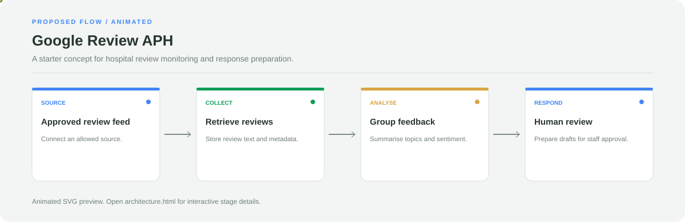

# Google Review APH

**A starter concept for hospital review monitoring and response preparation.**

[](https://github.com/chyk2468/googel-review-aph)

## 1. Project Title & Tagline

A starter concept for hospital review monitoring and response preparation.

## 2. Problem Statement

Review feedback can be difficult to monitor consistently across time. This repository is currently a placeholder, so the proposed flow below is a future direction rather than an implemented feature.

## 3. Project Preview

Add a screenshot or GIF of the current implementation. If the app is not runnable yet, use a clearly labelled concept mock-up instead of implying a live demo exists.

[Open interactive architecture](architecture.html)

## 4. Overview

This repository is a placeholder. The following flow is a proposal only.

## 5. Key Features

- Proposed review ingestion from an approved source.
- Proposed topic and sentiment grouping.
- Proposed response drafts for staff review.
- Human approval before publishing.

## 6. Architecture / Workflow



Open the [interactive architecture explorer](architecture.html) to select a stage and inspect its role.

**Status:** proposed workflow only. These features are not implemented in the current repository.

## 7. Tech Stack

Not implemented yet. Select a frontend, data store, and approved review integration after defining the scope.

## 8. Installation & Setup

```bash
git clone https://github.com/chyk2468/googel-review-aph.git
cd googel-review-aph
```

The current repository is a placeholder and does not have a runnable review-monitoring application.

## 9. Usage

No live review functionality is available yet. Begin with sample data and define privacy boundaries before connecting a live source.

## 10. Project Structure

Current repository contains a placeholder `index.html` and project documentation. The architecture diagram is a proposal.

## 11. Results & Demo

No implementation results or live demo are available yet.

## 12. Future Enhancements

- Define the approved data source and privacy boundaries.
- Build a basic interface using sample reviews.
- Add validation and audit logging.
- Add a human approval step before publishing responses.

## 13. License

Add a LICENSE file before granting reuse or redistribution permissions.
